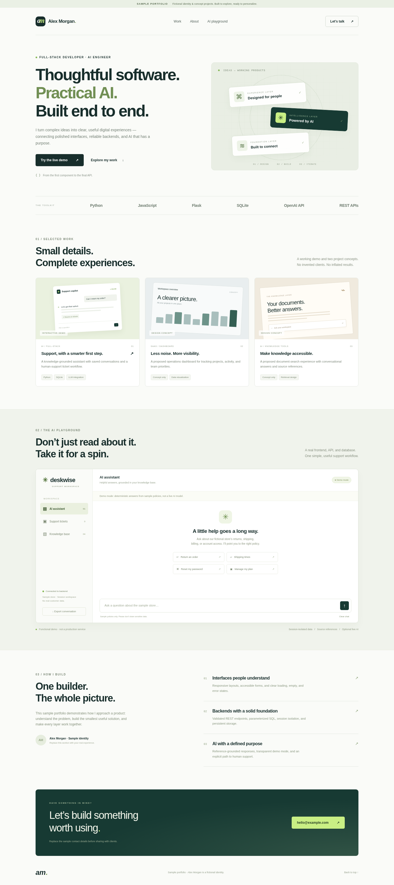

# Full-stack AI portfolio + Deskwise

A complete, deliberately small portfolio example for a Full Stack AI Engineer application. Includes a responsive portfolio and one working support-assistant project. **Alex Morgan is a fictional identity.** The other two project cards are clearly labeled design concepts, not completed client work.

## Video walkthroughs

| Version | Video | Subtitles |
|---|---|---|
| English narration · about 2:25 | [Watch / download MP4](videos/Deskwise-project-walkthrough.mp4) | [English SRT](videos/Deskwise-captions.srt) |
| Norwegian Bokmål narration · about 2:22 | [Watch / download MP4](videos/Deskwise-Norwegian-English-subtitles.mp4) | [English SRT](videos/Deskwise-Norwegian-English-subtitles.srt) |

The Norwegian video has English subtitles permanently visible. Both videos use AI-generated narration and show the built-in **demo mode**, not a live AI request. If GitHub does not play a video inline, use its download button. [English transcript and chapters](docs/presentation-notes.md).

<details>
<summary>Portfolio screenshot</summary>



</details>

## Quick start

Requires Python 3.10+.

```bash
cd full-stack-ai-portfolio
python -m venv .venv
source .venv/bin/activate
# Windows: .venv\Scripts\activate
pip install -r requirements.txt
python app.py
```

Open **http://localhost:3000**. No API key, JavaScript build step, CDN, images, or paid services are needed for the default demo. The SQLite database is created automatically.

## What works

- Responsive portfolio with work, process, and sample contact sections.
- Support chat about four fictional store policies.
- Persistent SQLite conversations, separated by signed browser sessions.
- Policy references that open the corresponding knowledge-base entry.
- Saved support tickets; mark resolved and reopen.
- Plain-text conversation export (desktop sidebar).
- Clear conversation, validation, loading states, and error feedback.
- Optional server-side OpenAI integration; the key never enters frontend code.

**Demo mode is deterministic keyword retrieval, not a running AI model.** Live mode retrieves up to two policy excerpts and sends them, recent conversation history, and the question to an OpenAI model. References identify the retrieved context; they are not independent verification of the generated answer. There is no vector database, document upload, order lookup, or real ticket delivery.

## Enable real AI (optional)

Set environment variables in the shell before starting. `.env.example` documents them; the app does not automatically load `.env` files.

```bash
export OPENAI_API_KEY="your-key"
export OPENAI_MODEL="gpt-4o-mini"
export SECRET_KEY="your-long-random-secret"
python app.py
```

In PowerShell use `$env:OPENAI_API_KEY="your-key"`. With a key configured, the UI shows **Live AI**. API usage is billed by the provider. Model access depends on your account. Messages and recent history are sent to OpenAI in live mode; do not enter sensitive data. Provider failures return a visible error rather than pretending a demo answer is live AI. Live-provider behavior requires your own key and has not been exercised in the supplied demo.

## Personalize before applying

1. Edit `templates/index.html`: replace Alex Morgan, AM initials, introductory copy, experience, title, and `hello@example.com`.
2. Replace concept cards with your real projects, links, technologies, and accurate contributions. Do not describe these sample designs as completed client work.
3. Keep the demo-mode disclosure. Remove fictional-identity labels only after replacing those details with truthful ones.
4. Edit `KNOWLEDGE` in `app.py` to change the sample policies. Edit `retrieve()` if changing the topic categories.
5. Edit CSS custom properties in `static/style.css` for brand colors.

## Suggested client walkthrough (2 minutes)

1. Open the portfolio and explain that Deskwise is a purpose-built portfolio demonstration.
2. Choose **Return an order**. Show the retrieved policy reference.
3. Click that reference to inspect the knowledge base.
4. Open **Support tickets**, create “Help with a delayed delivery,” and mark it resolved.
5. Refresh: conversation and tickets remain in the same browser session.
6. Explain that the same chat endpoint supports an optional real AI provider.

Example application text — adapt to reflect your actual contribution and skills:

> I prepared Deskwise, a full-stack support-assistant demo, to illustrate a practical AI workflow. It combines a responsive interface, a Python REST API, SQLite persistence, policy retrieval, and optional OpenAI integration. The demo also includes source references, session-separated conversations, and a support-ticket workflow. I’d be happy to walk you through the implementation and discuss how I would adapt it to your product.

## Structure

```text
app.py                 Flask endpoints, SQLite, retrieval, AI integration
static/app.js          Frontend state and interactions
static/style.css       Responsive styles, no external assets
templates/index.html   Portfolio and demo interface
tests/test_app.py      Backend tests
requirements.txt      Runtime/test packages
videos/               Both narrated MP4s and English subtitle files
docs/                 Portfolio screenshot and presentation transcript
.env.example           Optional configuration reference
```

## API

First call `GET /api/state` to establish a cookie session and get its CSRF token. Send that token in `X-CSRF-Token` for mutations and retain the session cookie.

| Endpoint | Purpose |
|---|---|
| `GET /api/state` | Mode, CSRF token, messages, tickets, policies |
| `POST /api/chat` | `{ "message": "How do refunds work?" }` |
| `DELETE /api/chat` | Delete this session’s conversation |
| `POST /api/tickets` | `{ "subject": "Delayed delivery" }` |
| `PATCH /api/tickets/<id>` | `{ "status": "resolved" }` or `"open"` |

## Tests

```bash
pytest -q
```

Six tests cover page rendering, chat persistence/deletion, input validation/CSRF, tickets and session isolation, unknown topics, and session-level rate limiting.

## Hosting and limitations

This is a portfolio demo, **not production-ready customer support**. Security basics include parameterized SQL, escaped text rendering, request-size limits, CSRF checks, HttpOnly/SameSite cookies, and session-scoped queries. These are not a substitute for a security review.

For a small hosted preview, install requirements, configure a **persistent** database path and a stable secret, and use a WSGI server instead of Flask's development server:

```bash
export SECRET_KEY="a-long-random-secret"
export DATABASE_PATH="/absolute/path/on/persistent-disk/demo.sqlite3"
export COOKIE_SECURE=1  # HTTPS deployment only
# Make sure the database directory exists and is writable.
gunicorn --bind 0.0.0.0:3000 --workers 1 --threads 4 --timeout 60 app:app
```

Without a fixed SECRET_KEY, server restarts invalidate cookies; old rows remain in SQLite but are no longer accessible to that session. Clearing browser cookies similarly loses access. A local session is not a user account. The contact link opens a mail client; there is no contact-form backend.

Before a public or client production launch add authentication/authorization, durable user identities, a shared abuse/cost limiter, backups, retention/deletion procedures for all data, monitoring, provider budget controls, appropriate privacy notices, and deployment security controls. Current limits (10 questions/minute and 50 saved exchanges per session, 30 tickets per session) are demo safeguards: visitors can create a new session or clear history to bypass them. Do not expose a paid API key publicly without stronger limits. SQLite is appropriate for this small single-instance demo, not a horizontally scaled deployment.
